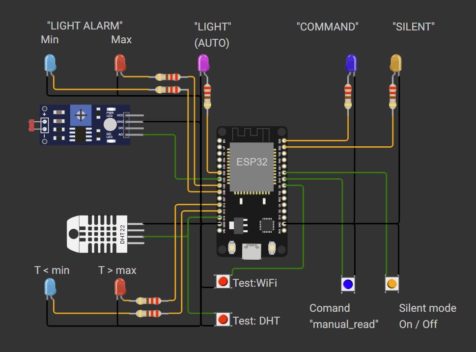

[🇬🇧 English](./README/README.en.md) | [🇺🇦 Українська](./README/README.uk.md)

# IoT Project

## Project Description

ESP32 firmware for environmental monitoring, local LED indication, and remote interaction through MQTT.

The firmware acquires temperature, humidity, and illuminance measurements; validates sensor data; maintains sensor and aggregated system status; synchronizes the device clock using NTP; manages Wi-Fi and MQTT connectivity; and exchanges telemetry, status messages, commands, and events with external services.

The code is divided into modules with defined responsibilities. Public interfaces are declared in header files, configuration is grouped into dedicated headers where practical, and the main application loop coordinates the modules. The shared `Telemetry` model carries sensor measurements and application state between modules.

This README documents the firmware architecture and the locations where developers should change configuration or extend behaviour. Values that depend on a deployment are represented by the names of constants and variables rather than fixed settings.

## Architecture Overview

The application entry point is `src/main.cpp`. It initializes the monitoring interface, shared telemetry model, sensors, buttons, indication subsystem, and Wi-Fi subsystem. The main loop schedules recurring work using elapsed-time checks and configuration constants from `src/app_config.h`.

The main loop coordinates these responsibilities:

- Initialize the shared telemetry data model and device-facing modules.
- Maintain Wi-Fi connectivity and process reconnection attempts.
- Read button input and update the button-state register.
- Acquire sensor measurements and maintain sensor-specific status.
- Mark measurements as stale when the stale-data watchdog runs.
- Synchronize system time while Wi-Fi is available.
- Initialize and maintain the MQTT connection when its prerequisites are met.
- Receive MQTT messages and process accepted commands.
- Recalculate the aggregated system-state register.
- Execute button-triggered actions and calculate the logical LED state.
- Detect LED-state changes and queue events for publication.
- Refresh the device timestamp and uptime.
- Publish telemetry or status, and publish pending outgoing commands and events.
- Optionally provide diagnostic output, HTTP transmission, and memory diagnostics.

The loop coordinates module calls; it does not contain the implementation details of sensor drivers, message formatting, connection services, or physical LED patterns. Most periodic operations are controlled by `src/app_config.h`. Subsystems maintain their own internal state where needed.

## Features

- DHT sensor acquisition for temperature and relative humidity.
- LDR ADC acquisition and conversion to illuminance.
- Sensor-specific measurement validation and alarm detection.
- Separate status flags for device errors, invalid measurements, stale data, and alarm conditions.
- Aggregated system-state register for operating modes and subsystem errors.
- Button processing with interrupt-based press detection and debounce handling.
- Configurable fixed or momentary button behaviour.
- Centralized application action processing.
- Logical LED-state calculation separated from GPIO output and indication patterns.
- Configurable continuous and blinking LED indications.
- Wi-Fi connection management and reconnection handling.
- NTP clock synchronization, retry handling, and timezone configuration.
- Selectable MQTT service implementation.
- MQTT telemetry, status, command, and event publication.
- MQTT message reception and incoming-command deserialization.
- LED-change event detection with deferred publication when MQTT is unavailable.
- Selectable telemetry serializer implementation.
- Serial Monitor diagnostics and optional payload output.
- Optional HTTP telemetry transmission.
- Device identification and optional memory diagnostics.

## Project Structure

The firmware source code is organized under `src/`. Project-level build and dependency configuration files are located in the project root. Review those files when changing the PlatformIO environment, board, framework, or library dependencies.

| Module or file | Responsibility |
| --- | --- |
| `src/main.cpp` | Initialization and main loop; schedules module handlers and coordinates subsystem lifecycle. |
| `src/app_config.h` | Application scheduling intervals and periodic-operation timing. |
| `src/hardware_config.h` | GPIO assignments for sensors, buttons, and LEDs. |
| `src/project_config.h` | Debug-build option and telemetry serializer selection. |
| `src/secrets_example.h` | Template for Wi-Fi credentials, MQTT test-broker settings, AWS IoT endpoint, and certificate material. |
| `src/secrets.h` | Local environment credentials and connection parameters consumed by the firmware; maintain this file locally and keep secrets out of version control. |
| `src/actions/` | Maps button and system/sensor state to application actions and logical LED states. |
| `src/buttons/` | Button initialization, interrupt handling, debounce processing, and button-state updates. |
| `src/commands_in/` | Internal model and state storage for incoming commands, plus command execution against application state. |
| `src/commands_out/` | Pending outgoing-command state and configured command names. |
| `src/dht_sensor/` | DHT measurement acquisition, validation, alarm detection, and status flags. |
| `src/ldr_sensor/` | LDR acquisition, illuminance calculation, validation, and status flags. |
| `src/telemetry/` | Shared telemetry structures, device metadata initialization, timestamp/uptime updates, and stale-data handling. |
| `src/system/` | Aggregated system-state register and subsystem error management. |
| `src/indication/` | LED indication masks, pattern configuration, and physical output control. |
| `src/events/` | LED-state change detection, pending-event state, and event publication coordination. |
| `src/wifi/` | Wi-Fi initialization, connection attempts, status tracking, and reconnection logic. |
| `src/time/` | NTP synchronization, timestamp access, and timezone management. |
| `src/mqtt/` | MQTT service abstraction, service selection, connection management, publication, reception, and topic configuration. |
| `src/serialization/` | Common serialization interface, message serializers, and incoming-message deserializers. |
| `src/monitor/` | Serial Monitor initialization, telemetry diagnostics, and optional payload output. |
| `src/device_info/` | Device identifier retrieval and device information output. |
| `src/http/` | Optional HTTP telemetry transmission. |
| `src/aws/` | AWS-related integration support; MQTT transport implementation is in `src/mqtt/`. |
| `src/memory/` | Runtime memory diagnostics. |

Each module's public interface is declared in its header file. Prefer extending an existing module through its public interface rather than adding subsystem-specific logic to `main.cpp`.

## Configuration Map

Use the configuration header responsible for the setting being changed. Avoid duplicating configuration values in unrelated modules.

| File | What to configure or review |
| --- | --- |
| `src/app_config.h` | Scheduling and intervals for buttons, actions, events, indication updates, Wi-Fi/MQTT checks, sensor reads, telemetry updates, stale-data checks, MQTT publication, HTTP test transmission, monitoring, and memory diagnostics. |
| `src/hardware_config.h` | Sensor, button, built-in LED, and indication LED GPIO assignments. |
| `src/project_config.h` | `DEBUG_MODE` and `TELEMETRY_SERIALIZER_ARDUINO_JSON`. |
| `src/secrets_example.h` / local `src/secrets.h` | `WIFI_SSID`, `WIFI_PASSWORD`, `MQTT_TEST_BROKER`, `MQTT_TEST_PORT`, `AWS_IOT_ENDPOINT`, `MQTT_AWS_PORT`, `AWS_CERT_CA`, `AWS_CERT_CRT`, and `AWS_CERT_PRIVATE`; review the optional client/thing identity setting when used by the selected service. |
| `src/buttons/buttons_config.h` | `BUTTON_DEBOUNCE_TIME_MS` and the `BUTTON_*_FIXED` behaviour switches. |
| `src/dht_sensor/dht_config.h` | DHT temperature and humidity validity limits and alarm thresholds. |
| `src/ldr_sensor/ldr_config.h` | LDR ADC and illuminance validity limits, illuminance alarm thresholds, and the low-light threshold. |
| `src/indication/indication_config.h` | Per-indication `INDICATION_*_MODE`, `INDICATION_*_BLINK_COUNT`, `INDICATION_*_BLINK_ON_MS`, and `INDICATION_*_BLINK_OFF_MS` settings. |
| `src/wifi/wifi_config.h` | Wi-Fi retry interval, connection timeout, retry-cycle delay, and maximum attempts. |
| `src/time/time_config.h` | `NTP_SERVER_1`, `NTP_SERVER_2`, `NTP_SERVER_3`, `LOCAL_TIMEZONE`, `DEFAULT_TIMEZONE`, and NTP synchronization/retry/timeout constants. |
| `src/mqtt/mqtt_config.h` | MQTT service selection, topic prefix and topic constants, QoS, socket timeout, keep-alive, reconnect policy, and message buffer capacity. |
| `src/commands_out/commands_out_config.h` | Symbolic outgoing command names such as `COMMAND_01`, `COMMAND_02`, and `COMMAND_03`. |
| `src/commands_in/commands_in_config.h` | Incoming-command configuration declarations; command types and current command state are defined in `commands_in.h` and `commands_in.cpp`. |
| `src/serialization/serialization_config.h` | `TELEMETRY_JSON_DOCUMENT_SIZE` for the ArduinoJson telemetry serializer. |
| `src/http/http.cpp` | `SERVER_URL`, the HTTP endpoint used by the optional HTTP transmission path. |

Build environment, board selection, framework configuration, and library dependencies are managed by the project-level build configuration above `src/`. Review those files when changing the PlatformIO environment or dependencies.

## Hardware Configuration

GPIO assignments are declared in `src/hardware_config.h`. Change the assignments there when adapting the firmware to a different circuit; sensor logic and indication logic should not need to know the physical pin mapping.

| Hardware function | Configuration constants |
| --- | --- |
| LDR analog input | `LDR_ADC_PIN` |
| DHT data input | `DHT_PIN` |
| Button inputs | `BUTTON_0_PIN`, `BUTTON_1_PIN`, `BUTTON_2_PIN`, `BUTTON_3_PIN` |
| Built-in LED | `LED_BUILTIN_PIN` |
| Command indication | `LED_COMMAND_PIN` |
| Manual-light indication | `LED_LIGHT_MANUAL_PIN` |
| Automatic/low-light indication | `LED_LIGHT_AUTO_PIN` |
| Minimum/maximum illuminance indications | `LED_LIGHT_MIN_PIN`, `LED_LIGHT_MAX_PIN` |
| Minimum/maximum temperature indications | `LED_TEMPERATURE_MIN_PIN`, `LED_TEMPERATURE_MAX_PIN` |
| Silent-mode indication | `LED_SILENT_PIN` |
| Humidity indications | `LED_HUMIDITY_MIN_PIN`, `LED_HUMIDITY_MAX_PIN` |

The humidity pin definitions are currently commented in `hardware_config.h`. Enable and assign them only when the circuit and the indication implementation support those outputs. Logical indication masks are independent of the physical GPIO assignments.

## Button Handling

Button processing is implemented in `src/buttons/`. `initButtons()` initializes the input subsystem, and `handleButtons()` processes input state and updates `Telemetry.buttonsState`.

Interrupt handlers record press activity; the regular loop applies debounce and the configured fixed/momentary behaviour. Button input processing is intentionally separate from action execution.

The button masks declared in `src/buttons/buttons.h` are:

- `BUTTON_COMMAND_MASK` — outgoing-command trigger.
- `BUTTON_SILENT_MASK` — silent-mode input.
- `BUTTON_LIGHT_MANUAL_MASK` — manual-light mode.
- `BUTTON_WIFI_DISABLE_MASK` — Wi-Fi disconnection test action.

Button behaviour is configured in `src/buttons/buttons_config.h`:

- `BUTTON_DEBOUNCE_TIME_MS`
- `BUTTON_0_FIXED`
- `BUTTON_1_FIXED`
- `BUTTON_2_FIXED`
- `BUTTON_3_FIXED`

A fixed button retains its logical state after release; a momentary button clears its state when released. Check the button implementation before changing the mapping between physical button numbers and state masks.

## Sensor Acquisition and Status

Each sensor module owns acquisition, validation, sensor-specific status, and updates to its section of `Telemetry`. The common model is declared in `src/telemetry/telemetry.h`; sensor status masks are declared in the corresponding sensor header.

### DHT sensor

The DHT implementation is in `src/dht_sensor/`.

- `initDhtSensor()` initializes the sensor.
- `handleDhtSensor()` reads and processes the measurement.
- `DHTData` stores `temperature`, `humidity`, `updated`, `uptime`, and `status`.

Validity limits and alarm thresholds are configured in `src/dht_sensor/dht_config.h`:

- `DHT_TEMPERATURE_VALID_MIN`
- `DHT_TEMPERATURE_VALID_MAX`
- `DHT_HUMIDITY_VALID_MIN`
- `DHT_HUMIDITY_VALID_MAX`
- `DHT_TEMPERATURE_ALARM_MIN`
- `DHT_TEMPERATURE_ALARM_MAX`
- `DHT_HUMIDITY_ALARM_MIN`
- `DHT_HUMIDITY_ALARM_MAX`

The status masks in `src/dht_sensor/dht_sensor.h` distinguish normal operation, device errors, stale data, invalid data, temperature alarms, humidity alarms, and initialization/error defaults:

- `STATUS_DHT_OK`
- `STATUS_DHT_DEVICE_ERR`
- `STATUS_DHT_DATA_STALE`
- `STATUS_DHT_DATA_VALID_ERR`
- `STATUS_DHT_TEMPERATURE_ALARM_MIN`
- `STATUS_DHT_TEMPERATURE_ALARM_MAX`
- `STATUS_DHT_HUMIDITY_ALARM_MIN`
- `STATUS_DHT_HUMIDITY_ALARM_MAX`
- `STATUS_DHT_ERR_INIT`

### LDR sensor

The LDR implementation is in `src/ldr_sensor/`.

- `initLdrSensor()` initializes the analog input and sensor state.
- `handleLdrSensor()` acquires the ADC value, calculates illuminance, validates the result, and updates status.
- `LDRData` stores `raw`, `lux`, `updated`, `uptime`, and `status`.

Validity and threshold configuration is in `src/ldr_sensor/ldr_config.h`:

- `LDR_ADC_VALID_MIN`
- `LDR_ADC_VALID_MAX`
- `LDR_LUX_VALID_MIN`
- `LDR_LUX_VALID_MAX`
- `LDR_LUX_ALARM_MIN`
- `LDR_LUX_ALARM_MAX`
- `LDR_LUX_THRESHOLD_LIGHT_LOW`

Status masks in `src/ldr_sensor/ldr_sensor.h` include:

- `STATUS_LDR_OK`
- `STATUS_LDR_DEVICE_ERR`
- `STATUS_LDR_DATA_STALE`
- `STATUS_LDR_DATA_VALID_ERR`
- `STATUS_LDR_LUX_ALARM_MIN`
- `STATUS_LDR_LUX_ALARM_MAX`
- `STATUS_LDR_LIGHT_LOW`
- `STATUS_LDR_ERR_INIT`

Device/read errors, invalid measurements, stale data, and alarm conditions are represented separately. Preserve this distinction when adding new validation rules: an invalid reading is not equivalent to a valid reading outside an alarm threshold.

## Shared Telemetry Model

The shared data model is declared in `src/telemetry/telemetry.h`. `Telemetry` is the common in-memory representation used by the application modules.

| Field | Purpose |
| --- | --- |
| `version` | Telemetry protocol version. |
| `device_id` | Device identifier. |
| `timestamp` | Current device timestamp. |
| `uptime` | Device uptime. |
| `dht` | DHT measurements, update metadata, and status. |
| `ldr` | LDR measurements, update metadata, and status. |
| `buttonsState` | Button-state register. |
| `systemState` | Aggregated system-state register. |
| `ledState` | Logical LED indication-state register. |

`DHTData` contains `temperature`, `humidity`, `updated`, `uptime`, and `status`. `LDRData` contains `raw`, `lux`, `updated`, `uptime`, and `status`. The protocol version is identified by `TELEMETRY_PROTOCOL_VERSION`.

The telemetry lifecycle functions are:

- `initTelemetry()` initializes metadata and application-state fields.
- `updateTelemetry()` refreshes the timestamp and uptime.
- `updateStaleStatus()` marks sensor data as stale when called by the application watchdog.

Modules should update only the fields for which they are responsible. The serialization layer chooses which fields are exposed in external message formats; not every in-memory field is included in telemetry JSON.

## System State Register

The aggregated state is managed by `src/system/system_state.cpp`, with masks declared in `src/system/system_state.h`. The register is stored in `Telemetry.systemState`; `updateSystemState()` recalculates managed operating-state bits and clears subsystem error bits after the relevant subsystem is confirmed healthy.

The masks are:

- `SYSTEM_SILENT_MASK`
- `SYSTEM_LDR_ERR_MASK`
- `SYSTEM_DHT_ERR_MASK`
- `SYSTEM_TIME_ERR_MASK`
- `SYSTEM_MQTT_ERR_MASK`
- `SYSTEM_WIFI_ERR_MASK`
- `SYSTEM_LIGHT_MANUAL_MASK`
- `SYSTEM_COMMAND_MASK`
- `SYSTEM_STATE_MANAGED_MASK`
- `SYSTEM_STATE_ERR_INIT_MASK`

The system-state register aggregates selected application modes and subsystem errors. Sensor-specific detail remains in `Telemetry.dht.status` and `Telemetry.ldr.status`; do not replace those flags with the aggregate error bits.

## Stale-Data Handling

Stale-data handling is coordinated by `src/main.cpp` and implemented through the telemetry module. The relevant constants are declared in `src/app_config.h`:

- `TELEMETRY_UPDATE_INTERVAL_MS`
- `SENSOR_STALE_AFTER_CYCLES`
- `SENSOR_STALE_INTERVAL_MS`

The watchdog marks both sensor datasets stale when it runs. A successful sensor update is responsible for clearing the relevant stale flag in the sensor module. Stale status indicates that data has not been refreshed as expected; it is distinct from a device error or an invalid measurement.

When changing sensor sampling intervals, review the telemetry update and stale-data timing constants together so that the stale watchdog remains consistent with the acquisition schedule.

## Actions and LED State

Application actions are implemented in `src/actions/`. `handleActions()` processes button-triggered operations and updates the logical LED-state register, `Telemetry.ledState`.

The action module handles the outgoing-command trigger and the Wi-Fi disconnection test action. It also maps the current system and sensor states to indication masks:

- `SYSTEM_LIGHT_MANUAL_MASK` to `INDICATION_LIGHT_MANUAL_MASK`.
- `SYSTEM_COMMAND_MASK` to `INDICATION_COMMAND_MASK`.
- `SYSTEM_SILENT_MASK` to `INDICATION_SILENT_MASK`.
- LDR alarm and low-light status to the corresponding illuminance indications.
- DHT temperature and humidity alarm status to their corresponding indications.

The logical state is separate from physical GPIO output. Change the state mapping in `src/actions/actions.cpp`; change output pins in `src/hardware_config.h`; change output patterns in `src/indication/indication_config.h`.

## LED Indication

The indication subsystem is implemented in `src/indication/`. `initIndication()` initializes the outputs, `requestIndication()` requests transient subsystem indications, and `handleLedIndication()` applies the logical `ledState` to the outputs. `startStartupBlink()` is available for startup indication.

`IndicationMode` represents continuous or blinking behaviour. `IndicationPattern` describes a pattern, and `LedIndicationState` stores the output mask, pin, pattern, and runtime state for pattern execution. `IndicationType` identifies transient indications such as MQTT publication and Wi-Fi connection activity.

Logical masks declared in `src/indication/indication.h` include:

- `INDICATION_LIGHT_MIN_MASK`
- `INDICATION_LIGHT_MAX_MASK`
- `INDICATION_LIGHT_AUTO_MASK`
- `INDICATION_LIGHT_MANUAL_MASK`
- `INDICATION_TEMPERATURE_MIN_MASK`
- `INDICATION_TEMPERATURE_MAX_MASK`
- `INDICATION_HUMIDITY_MIN_MASK`
- `INDICATION_HUMIDITY_MAX_MASK`
- `INDICATION_SILENT_MASK`
- `INDICATION_COMMAND_MASK`
- `ALL_INDICATION_MASK`

Pattern settings are declared in `src/indication/indication_config.h`. The per-indication groups use `INDICATION_*_MODE`, `INDICATION_*_BLINK_COUNT`, `INDICATION_*_BLINK_ON_MS`, and `INDICATION_*_BLINK_OFF_MS`, including startup, command, light, temperature, humidity, silent, MQTT publication, and Wi-Fi connection indications.

The humidity indication masks and pattern settings exist in the module, but the corresponding hardware pin definitions are commented in `hardware_config.h`. Hardware and logical configuration must be made consistent before enabling those outputs.

## Incoming and Outgoing Commands

Commands are separated from transport and application actions.

### Incoming commands

The incoming-command model is defined in `src/commands_in/commands_in.h` and implemented in `commands_in.cpp`.

- `CommandTarget` identifies the target.
- `CommandAction` identifies the requested operation.
- `CommandValue` represents the requested value.
- `IncomingCommand` groups the target, action, and value.

The public state functions are `setIncomingCommand()`, `getIncomingCommand()`, and `clearIncomingCommand()`. `handleIncomingCommands()` applies an accepted command to the internal application state.

The current command model includes `CommandTarget::Led`, `CommandAction::Set`, and `CommandValue` members for `On`, `Off`, and `Toggle`. External JSON parsing and validation belong in the deserialization layer, not in the MQTT connection implementation.

### Outgoing commands

Outgoing command state is managed by `src/commands_out/`.

- `setOutgoingCommand()` sets the pending command.
- `getOutgoingCommand()` returns the pending command name.
- `clearOutgoingCommand()` clears the pending command.

The symbolic names are declared in `src/commands_out/commands_out_config.h` as `COMMAND_01`, `COMMAND_02`, and `COMMAND_03`. The action module sets a command when the associated button transition is detected; the MQTT publication layer serializes and publishes the pending command.

## Events

Event state and detection are implemented in `src/events/`. The public handler is `handleEvents()`.

The current event logic observes the manual-light indication bit in `Telemetry.ledState`. Its first observation initializes the previous state and does not create a change event. A subsequent transition creates a pending LED-change event. If MQTT is unavailable, the event remains pending for a later attempt; after successful publication, the pending state is cleared.

Event message formatting is implemented in `src/serialization/serializers/events_serializer.cpp` and exposed through the common serialization interface. The public serializer functions include `serializeEventSnprintf()` and `serializeLedChangedSnprintf()`. The MQTT publication interface includes `publishLedChanged()` and `publishEvent()`.

When changing event behaviour, keep event detection (`src/events/`), message representation (`src/serialization/`), and transport publication (`src/mqtt/`) separate.

## Wi-Fi Management

Wi-Fi management is implemented in `src/wifi/`.

- `initWiFi()` initializes station mode.
- `connectWifi()` starts a connection attempt.
- `disconnectWiFi()` requests disconnection.
- `isWifiConnected()` reports the tracked connection state.
- `handleWiFi()` processes connection status, timeouts, and reconnect scheduling.

Configuration is in `src/wifi/wifi_config.h`:

- `WIFI_RECONNECT_INTERVAL_MS`
- `WIFI_CONNECTION_TIMEOUT_MS`
- `WIFI_RECONNECT_CYCLE_DELAY_MS`
- `WIFI_MAX_CONNECTION_ATTEMPTS`

Wi-Fi state is consumed by the time and MQTT subsystems and contributes to the aggregated system-state register. If Wi-Fi is lost, the main loop invalidates time synchronization and waits for connectivity before continuing the normal time/MQTT initialization path.

## Time Synchronization

Time functions are implemented in `src/time/`; NTP servers, timezone selection, and synchronization timing are configured in `src/time/time_config.h`.

The public interface includes:

- `handleTimeSynchronization()`
- `isTimeSynchronized()`
- `invalidateTimeSync()`
- `getCurrentTimestamp()`
- `getCurrentUtcTime()`
- `getLocalTime()`
- `setTimezone()`

Configuration identifiers include `NTP_SERVER_1`, `NTP_SERVER_2`, `NTP_SERVER_3`, `LOCAL_TIMEZONE`, `DEFAULT_TIMEZONE`, and `currentTimezone`. Timing is controlled by `NTP_SYNC_INTERVAL_MIN`, `NTP_SYNC_INTERVAL_MS`, `NTP_SYNC_RETRY_INTERVAL_MS`, and `NTP_SYNC_TIMEOUT_MS`.

The implementation distinguishes an attempt in progress from a successfully synchronized clock. It retries after failure and performs periodic synchronization after success. Device timestamps are retrieved from the system clock; local calendar time uses the configured timezone. The main loop coordinates synchronization with Wi-Fi connectivity and only initializes MQTT when the required Wi-Fi and time conditions are satisfied.

## MQTT Communication

MQTT code is organized under `src/mqtt/`. The subsystem separates the service abstraction, service selection, connection lifecycle, publication, and reception.

### Service selection

`src/mqtt/mqtt_config.h` selects the service through `MQTT_SERVICE_AWS` or `MQTT_SERVICE_TEST`. Exactly one service must be enabled. `MqttServiceType` aliases the selected implementation, either `MqttAwsService` or `MqttTestService`.

`MqttService` defines the transport interface used by the MQTT subsystem. Service-specific broker behaviour is implemented in `mqtt_aws_service.cpp` and `mqtt_test_service.cpp`.

### Topic configuration

Topics are derived from `MQTT_TOP_TOPIC` in `src/mqtt/mqtt_config.h`:

- `TOPIC_COMMANDS_LED` — incoming led command subscription.
- `TOPIC_COMMANDS_OUT` — outgoing command publication topic.
- `TOPIC_TELEMETRY` — telemetry publication topic.
- `TOPIC_EVENTS` — event publication topic.

The subscription filter and outgoing command topic are intentionally distinct. Keep topic definitions consistent with broker authorization, external consumers, and the selected service.

### Connection configuration

The following constants are defined in `src/mqtt/mqtt_config.h`:

- `MQTT_SUBSCRIBE_QOS`
- `MQTT_PUBLISH_QOS`
- `MQTT_SOCKET_TIMEOUT_SEC`
- `MQTT_KEEP_ALIVE`
- `MQTT_RECONNECT_INTERVAL_MS`
- `MQTT_MAX_CONNECTION_ATTEMPTS`
- `MQTT_RECONNECT_CYCLE_DELAY_MS`
- `MQTT_BUFFER_SIZE`

Compile-time checks validate service selection and supported QoS configuration. Review the selected MQTT client library's capabilities before changing QoS or buffer-related settings.

### Connection lifecycle

The connection interface is declared in `src/mqtt/mqtt_connection.h`:

- `initMqtt()`
- `isMqttConnected()`
- `handleMqttConnection()`
- `mqttPublish()`

The connection layer manages service initialization, connection state, subscriptions, and transport publication. It does not own JSON formatting or application-level command semantics.

### Publication

Publication interfaces are declared in `src/mqtt/mqtt_publish.h`:

- `publishStatus()`
- `publishTelemetry()`
- `publishCommands()`
- `publishLedChanged()`
- `publishEvent()`

`handleMqttSensors()` selects telemetry or status publication according to the silent-mode state. `handleMqttCommands()` handles pending outgoing commands. `publishManualTrigger()` coordinates the manual-trigger publication path.

The main loop invokes periodic MQTT publication when connectivity prerequisites are met. `MQTT_PUBLISH_INTERVAL_MS` controls the periodic publication schedule; `TOPIC_*` constants identify the destination topics.

### Reception

Incoming message reception is declared in `src/mqtt/mqtt_receive.h`; `handleMqttMessage()` receives the topic and payload and delegates interpretation to the serialization/deserialization layer. The MQTT callback, JSON parsing, internal command model, application action logic, and physical LED output remain separate responsibilities.

## Serialization and Deserialization

Serialization is organized under `src/serialization/`. The common interface is declared in `src/serialization/serialization.h`; MQTT code should use this interface rather than depend on individual serializer implementation files.

### Telemetry serialization

The default formatter is implemented in `src/serialization/serializers/telemetry_serializer.cpp` and exposes `serializeTelemetrySnprintf()`. An alternative ArduinoJson implementation is in `telemetry_serializer_aj.cpp` and exposes `serializeTelemetryArduinoJson()`.

The selection switch is `TELEMETRY_SERIALIZER_ARDUINO_JSON` in `src/project_config.h`. The ArduinoJson document capacity is configured by `TELEMETRY_JSON_DOCUMENT_SIZE` in `src/serialization/serialization_config.h`.

The common `serializeTelemetry()` interface selects the implementation. The outgoing telemetry representation includes device metadata, sequence information, DHT measurements and status, LDR measurements and status, and the aggregated system state. The in-memory fields `buttonsState` and `ledState` are not part of the current telemetry JSON representation. Keep both serializer implementations consistent when changing the telemetry message schema.

### Status serialization

Status serialization is implemented in `src/serialization/serializers/status_serializer.cpp` and exposed through `serializeStatusSnprintf()` and the common `serializeStatus()` interface. It provides device metadata, sequence information, and sensor/system status fields, with a message type that distinguishes it from normal telemetry.

### Command serialization

Outgoing command formatting is implemented in `src/serialization/serializers/commands_serializer.cpp`. `serializeCommandsSnprintf()` converts the pending command name into a JSON message. Command names are maintained by the outgoing-command module.

### Event serialization

Event formatting is implemented in `src/serialization/serializers/events_serializer.cpp`. `serializeEventSnprintf()` handles a general event and optional value; `serializeLedChangedSnprintf()` formats the LED-change event. The common interface exposes `serializeEvent()` and `serializeLedChanged()`.

### Deserialization

Command deserialization is implemented in `src/serialization/deserializers/commands_deserializer.cpp`. `deserializeCommand()` accepts the incoming topic and payload, validates the JSON representation, and maps supported values to `IncomingCommand`.

A telemetry deserializer interface is also present in `src/serialization/deserializers/telemetry_deserializer.h` through `deserializeTelemetry()`. The external message representation should be parsed at this boundary rather than inside transport or application modules.

## Diagnostics and Monitoring

Monitoring is implemented in `src/monitor/`.

- `initMonitor()` initializes monitoring.
- `handleMonitor()` prints diagnostic information from the shared telemetry model.
- `printMonitorPayload()` prints a formatted payload when `DEBUG_MODE` is enabled.

The debug switch is declared in `src/project_config.h`. Monitoring output is separate from serialization and network publication, so diagnostic presentation can be changed without altering the message format or transport behaviour.

The main loop schedules monitoring through `DATA_MONITOR_INTERVAL_MS` within the `DEBUG_MODE` section.

## Device Identification

Device identification is implemented in `src/device_info/`.

- `getDeviceId()` retrieves the device identifier used by the telemetry model.
- `printDeviceInfo()` outputs device information.

The identifier is stored in `Telemetry.device_id`. The device-info module encapsulates retrieval and display so that sensor modules and transport code do not need to implement device identification themselves.

## HTTP Support

Optional HTTP telemetry transmission is implemented in `src/http/`. The public interface is `handleSendData()`.

The module checks Wi-Fi connectivity, serializes telemetry through the common serialization interface, and sends the resulting JSON payload to `SERVER_URL`, currently defined in `src/http/http.cpp`.

The application loop contains a scheduled HTTP call site under `DEBUG_MODE`, and that call is currently commented out in `main.cpp`. To enable this path, review both the call site and the endpoint configuration. HTTP transmission is separate from MQTT publication.

## AWS Integration

AWS-related support has a directory under `src/aws/`; the AWS IoT MQTT transport implementation is in `src/mqtt/mqtt_aws_service.cpp` and its interface is declared in `mqtt_aws_service.h`.

Service selection is controlled by `MQTT_SERVICE_AWS` in `src/mqtt/mqtt_config.h`. AWS connection material is configured through local `src/secrets.h`, based on `src/secrets_example.h`.

The relevant identifiers include:

- `AWS_IOT_ENDPOINT`
- `AWS_CERT_CA`
- `AWS_CERT_CRT`
- `AWS_CERT_PRIVATE`
- `MQTT_AWS_PORT`

The endpoint, client identity, certificate, private key, and trusted CA must correspond to the registered AWS IoT device and its authorization policy. AWS IoT policies, rules, and external consumers must also agree with the topic constants and message formats used by the firmware.

## Memory Diagnostics

Memory diagnostics are implemented in `src/memory/`; the public function is `checkMemory()`.

The module reports runtime memory information using the ESP32 runtime interface. The main loop contains a scheduled invocation under `DEBUG_MODE`, and that call is currently commented out in `main.cpp`. Review the call site and `MEMORY_CHECK_INTERVAL_MS` when enabling or changing memory diagnostics.

## Build and Run

The project is intended for the ESP32 Arduino framework and PlatformIO. Build-environment details are configured in project-level files located above `src/`.

### Configuration workflow

1. Open the complete project, including the project-level build configuration.
2. Verify the selected PlatformIO environment, board, framework, and library dependencies.
3. Create the local `src/secrets.h` from `src/secrets_example.h`; do not commit credentials or private key material.
4. Configure `WIFI_SSID` and `WIFI_PASSWORD`.
5. Select exactly one MQTT service using `MQTT_SERVICE_AWS` or `MQTT_SERVICE_TEST`.
6. Configure the connection parameters required by the selected service.
7. For AWS IoT Core, configure `AWS_IOT_ENDPOINT`, `MQTT_AWS_PORT`, `AWS_CERT_CA`, `AWS_CERT_CRT`, and `AWS_CERT_PRIVATE`.
8. Review `MQTT_TOP_TOPIC` and the derived `TOPIC_*` constants in `src/mqtt/mqtt_config.h`.
9. Check GPIO assignments in `src/hardware_config.h` against the actual circuit.
10. Review sensor validity and alarm thresholds in `dht_config.h` and `ldr_config.h`.
11. Review button behaviour in `src/buttons/buttons_config.h`.
12. Review LED indication patterns in `src/indication/indication_config.h`.
13. Review scheduling and stale-data handling in `src/app_config.h`.
14. Review NTP servers and timezone selection in `src/time/time_config.h`.
15. Select the telemetry serializer through `TELEMETRY_SERIALIZER_ARDUINO_JSON` when needed.
16. Build and upload using the configured PlatformIO environment.
17. Open the Serial Monitor and inspect connectivity diagnostics, sensor status, system state, and serialized messages.

### Secrets and credentials

`src/secrets_example.h` is a template, not a location for production credentials. Local `src/secrets.h` contains environment-specific Wi-Fi and broker/AWS connection material. Keep Wi-Fi credentials, private keys, and other secrets out of version control.

### External service consistency

When using an external MQTT broker or AWS IoT Core, keep the service configuration, device identity, credentials, topic constants, authorization policy, and consuming services aligned. AWS IoT Rules, backend services, and storage components must parse the message structure produced by the selected serializer.

## Module Boundaries and Design Principles

### Shared data model

`Telemetry` is the shared in-memory data model. Sensor modules update their own data structures; the button module updates `buttonsState`; the system-state module maintains `systemState`; and the action module calculates `ledState`. Serialization exposes a selected subset of this state externally.

### Symbolic configuration

Hardware mapping, scheduling, validity limits, alarm thresholds, connection behaviour, timezone settings, and indication patterns are declared through named constants in dedicated configuration headers. Update the owning configuration header rather than duplicating values throughout the code.

### State separation

The firmware keeps separate representations for:

- Button input state.
- DHT measurements and status.
- LDR measurements and status.
- Aggregated system operation and errors.
- Logical LED indication state.
- Incoming command state.
- Outgoing command state.
- Pending event state.
- Wi-Fi connection state.
- Time synchronization state.
- MQTT connection state.

Each state has a distinct purpose. The system-state and action modules coordinate states where required without collapsing all state into one register.

### Communication separation

The MQTT service abstraction isolates broker-specific transport behaviour. Connection management, publication, reception, JSON serialization, command deserialization, and application-level command handling have separate responsibilities.

### Extendability

Extend the module that owns the behaviour being changed. Add sensor validation to the sensor module, new indication patterns to the indication configuration and implementation, topic changes to MQTT configuration, and external message-format changes to the serialization layer. Preserve the boundaries between hardware mapping, application state, transport handling, and message representation.

---

[🇬🇧 English](./README/README.en.md) | [🇺🇦 Українська](./README/README.uk.md)
